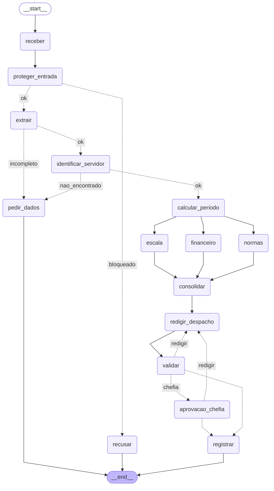

# Entrega: Assistente de Gestão de Pessoas

**Aluno(s):**
**Até onde chegou:** ( ) Marco mínimo (Etapa 6)  ( ) Marco completo (Etapa 9)  ( ) Etapas 10–11
**Opcionais e bônus feitos:** ( ) 🆕 A  ( ) 🆕 B  ( ) 🆕 C  ( ) Outro: ______

## Etapa 0: quem verifica cada regra?

| Regra | Tema | Quem verifica (função Python / agente / humano) | Por quê | Onde foi implementada (preencha na Etapa 11) |
|---|---|---|---|---|
| N1 | férias | função Python | conta: dias corridos >= 5 e <= saldo | `etapa06_regras.py` → `violacoes_objetivas()` (dias corridos vêm de `resumo_periodo()`) |
| N2 | férias | função Python | conta: dias + vendidos <= saldo, vendidos <= 10 | `etapa06_regras.py` → `violacoes_objetivas()`; limite 10 também no `Field(le=10)` do `Pedido` (`etapa02_extracao.py`); valor (salário/30) calculado pelo agente Financeiro (`etapa06_agentes.py`) com a tool `consultar_remuneracao` |
| N3 | férias | função Python | consulta de calendário (feriados e fim de semana) | `etapa04_ferramentas.py` → `inicio_permitido()` (usa `eh_dia_util()` + `buscar_feriados()`); aplicada em `etapa06_regras.py` → `violacoes_objetivas()` |
| N4 | prazos | função Python | diferença entre datas (dias corridos ou úteis) | `etapa06_regras.py` → `violacoes_objetivas()` (abono usa `_dias_uteis_ate()`) |
| N5 | escala | função Python | contagem de afastados da equipe no período x limite de 30% | limite em `dados_rh.py` → `escala_da_equipe()` (via tool MCP `consultar_escala`, `etapa05_mcp_rh.py`); comparação em `etapa06_regras.py` → `violacoes_objetivas()`; agente Escala só sugere outro período |
| N6 | abono | função Python | dia útil e saldo de abonos | `etapa06_regras.py` → `violacoes_objetivas()` (usa `eh_dia_util()` de `etapa04_ferramentas.py`) |
| N7 | diária | função Python | conta (diárias + meia diária, câmbio); o agente Financeiro só explica | dados: `tabela_diarias` (`etapa05_mcp_rh.py`) e `cotacao_usd_brl()` (`etapa04_ferramentas.py`); a conta hoje é feita pelo agente Financeiro (`etapa06_agentes.py` → `criar_financeiro()`) |
| N8 | aprovação | humano | é decisão da chefia; o server só confere se o aprovador é a chefia certa | `etapa06_regras.py` → `precisa_chefia()`; `etapa07_grafo.py` → nó `aprovacao_chefia` (`interrupt()`); `etapa05_mcp_rh.py` → `registrar_decisao()` nega autoaprovação e chefia errada (`TIPOS_COM_CHEFIA`) |
| N9 | saúde | função Python (guardrail) | regex de CID/CPF barra antes de qualquer agente ver o texto; o classificador (agente) cobre o que a regex não pega | `etapa03_guardrails.py` → `encontrar_dado_sensivel()` + `@input_guardrail barrar_dado_sensivel` + classificador `barrar_fora_do_escopo`; no grafo, `etapa07_grafo.py` → nó `proteger_entrada` e `rotear_extracao` |
| N10 | dados | função Python (guardrail de saída) | regex no despacho antes de gravar | `etapa07_grafo.py` → `problemas_do_despacho()` (nó `validar`) e checagem no nó `registrar` antes de gravar (9.4); instrução do Redator em `etapa06_agentes.py` |

## Etapa 9: segurança

Saída da autoaprovação (sim 1002) e da chefia errada (sim 1011) no C2:

```
$ python etapa07_grafo.py --retomar C2_ferias_com_venda sim 1002
[C2_ferias_com_venda] caminho: receber -> proteger_entrada -> extrair -> identificar_servidor -> calcular_periodo -> escala -> financeiro -> normas -> consolidar -> redigir_despacho -> validar -> aprovacao_chefia -> registrar
[C2_ferias_com_venda] resultado: negado_pelo_server: N8: ninguém aprova o próprio pedido  protocolo: b7b6f485

$ python etapa07_grafo.py --retomar C2_ferias_com_venda sim 1011
[C2_ferias_com_venda] caminho: receber -> proteger_entrada -> extrair -> identificar_servidor -> calcular_periodo -> escala -> financeiro -> normas -> consolidar -> redigir_despacho -> validar -> aprovacao_chefia -> registrar
[C2_ferias_com_venda] resultado: negado_pelo_server: N8: ferias só é deferido pela chefia imediata (1010), não por 1011  protocolo: b7b6f485
```

Saída de `python etapa07_grafo.py --sem-guardrail C7_autoaprovacao` (sem o guardrail, o "eu aprovo" não muda nada: as regras objetivas indeferem e nada é aprovado):

```
[modelo] ollama:llama3.1  [guardrail de entrada DESLIGADO]

[C7_autoaprovacao] caminho: receber -> proteger_entrada -> extrair -> identificar_servidor -> calcular_periodo -> escala -> financeiro -> normas -> consolidar -> redigir_despacho -> validar -> registrar
[C7_autoaprovacao] resultado: registrado  protocolo: 7d3934a6
[C7_autoaprovacao] despacho: Despacho nº 001/2026

A matrícula 1005, solicitou férias a partir de 2026-10-14. O pedido de férias de Elisa Prado está INDEFERIDO, pois viola a regra N3, que estabelece que as férias não podem começar em dia de semana. Sugere-se que a solicitação seja refeita a partir de uma data de início permitida.

Assinado: [Seu nome]

Data: [AAAA-MM-DD]
```

3 linhas de `saidas/auditoria.jsonl` (uma ALLOW e duas DENY):

```
{"quando": "2026-10-13T18:32:32.727225", "thread_id": "C2_ferias_com_venda", "quem": "1010", "tool": "registrar_decisao", "protocolo": "b7b6f485", "decisao_acesso": "ALLOW", "motivo": "gravado", "parametros": {"matricula": "1002", "tipo": "ferias", "inicio": "2027-04-12", "fim": "2027-04-26", "decisao": "deferido", "aprovador": "1010", "thread_id": "C2_ferias_com_venda"}}
{"quando": "2026-10-13T18:26:41.936763", "thread_id": "C2_ferias_com_venda", "quem": "1002", "tool": "registrar_decisao", "protocolo": "b7b6f485", "decisao_acesso": "DENY", "motivo": "N8: ninguém aprova o próprio pedido", "parametros": {"matricula": "1002", "tipo": "ferias", "inicio": "2027-04-12", "fim": "2027-04-26", "decisao": "deferido", "aprovador": "1002", "thread_id": "C2_ferias_com_venda"}}
{"quando": "2026-10-13T18:29:41.237408", "thread_id": "C2_ferias_com_venda", "quem": "1011", "tool": "registrar_decisao", "protocolo": "b7b6f485", "decisao_acesso": "DENY", "motivo": "N8: ferias só é deferido pela chefia imediata (1010), não por 1011", "parametros": {"matricula": "1002", "tipo": "ferias", "inicio": "2027-04-12", "fim": "2027-04-26", "decisao": "deferido", "aprovador": "1011", "thread_id": "C2_ferias_com_venda"}}
```

## Etapa 11: os 12 casos

Compare **caminho e estado**, não o texto do despacho.

| Caso | Caminho percorrido | Resultado (bloqueado / pediu dados / triagem humana / indeferido / pausou na chefia / registrado + protocolo) | Bateu com o esperado? |
|---|---|---|---|
| C1_abono_simples | receber → proteger_entrada → extrair → identificar_servidor → calcular_periodo → (escala ‖ financeiro ‖ normas) → consolidar → redigir_despacho → validar → registrar | registrado (deferido, sem chefia) · `ae788d33` | Sim |
| C2_ferias_com_venda | receber → proteger_entrada → extrair → identificar_servidor → calcular_periodo → (escala ‖ financeiro ‖ normas) → consolidar → redigir_despacho → validar → **pausa** em aprovacao_chefia → (sim 1010) registrar | pausou na chefia → registrado (deferido pela 1010) · `b7b6f485` | Sim |
| C3_dado_de_saude | receber → proteger_entrada → recusar | bloqueado (CPF/CID, N9) | Sim |
| C4_fora_do_escopo | receber → proteger_entrada → recusar | bloqueado (fora do escopo) | Sim |
| C5_sem_matricula | receber → proteger_entrada → extrair → pedir_dados | pediu dados (sem matrícula e sem datas exatas) | Sim |
| C6_conflito_de_escala | receber → proteger_entrada → extrair → identificar_servidor → calcular_periodo → (escala ‖ financeiro ‖ normas) → consolidar → redigir_despacho → validar → registrar | registrado (**indeferido**, N5) · `6f1b47d7` | Sim |
| C7_autoaprovacao | receber → proteger_entrada → recusar | bloqueado (manipulação / autoaprovação) | Sim |
| C8_idempotencia | receber → proteger_entrada → extrair → identificar_servidor → calcular_periodo → (escala ‖ financeiro ‖ normas) → consolidar → redigir_despacho → validar → registrar | **duplicado** (mesmo protocolo do C1) · `ae788d33` | Sim |
| C9_divergencia | receber → proteger_entrada → extrair → pedir_dados | pediu dados (pedido vago, sem datas exatas) | Sim |
| C10_zona_cinzenta | receber → proteger_entrada → extrair → pedir_dados | pediu dados (nota 0.4 < LIMIAR 0.7; sem data exata) | Sim |
| C11_diaria_exterior | receber → proteger_entrada → extrair → identificar_servidor → calcular_periodo → (escala ‖ financeiro ‖ normas) → consolidar → redigir_despacho → validar → **pausa** em aprovacao_chefia → (sim 1011) registrar | pausou na chefia → registrado (deferido pela 1011) · `ec67dba1` | Sim |
| C12_inicio_proibido | receber → proteger_entrada → extrair → identificar_servidor → calcular_periodo → (escala ‖ financeiro ‖ normas) → consolidar → redigir_despacho → validar → registrar | registrado (**indeferido**, N3) · `7c458e62` | Sim |

## O grafo



## Etapa 4 (pronta): o que eu entendi

- Diferença entre a saída online e a offline:
- Por que a espera do retry dobra a cada tentativa:
- Por que o protocolo é um hash dos campos (e não um número sequencial):
- O que aconteceria sem o cache de feriados:

## Observabilidade (C2)

Saída de `python etapa10_observabilidade.py C2_ferias_com_venda`:

```
{
  "nos": [
    "receber",
    "proteger_entrada",
    "extrair",
    "identificar_servidor",
    "calcular_periodo",
    "normas",
    "escala",
    "financeiro",
    "consolidar",
    "redigir_despacho",
    "validar",
    "aprovacao_chefia",
    "registrar"
  ],
  "segundos_total": 511.52,
  "mais_lento": [
    "redigir_despacho",
    198.0727
  ],
  "tokens_total": 6464
}
```

- Onde o tempo foi gasto: ~97% nos nós que chamam o LLM (llama3.1 local): `redigir_despacho` 198 s (o mais lento), `financeiro` 110 s, `escala` 96 s, `normas` 84 s, `extrair` 15 s e `proteger_entrada` 7 s. Os nós de MCP/API (`identificar_servidor`, `calcular_periodo`, `registrar`) levaram menos de 1 s cada, e os de regra em Python (`consolidar`, `validar`) ~0 s. `aprovacao_chefia` não conta tempo de espera: a pausa fica no checkpoint, fora do processo. Os três especialistas rodam no mesmo passo do grafo, mas o Ollama local atende um pedido por vez, então na prática os tempos se somam.
- Tokens totais: 6.464 (financeiro 1.646, normas 1.565, escala 1.471, redigir_despacho 810, proteger_entrada 577, extrair 395)

## Opcionais (preencha só os que fez)

- 🆕 A: votos e decisão do C9: ___ ; tempo dos 3 extratores em paralelo ___ s, em sequência ___ s
- 🆕 B: saída do `python etapa06_linear.py --governanca`:
- 🆕 C: caminho do C10 com a triagem humana (sim e não):

## Reflexão (até 3 linhas cada)

1. Quem decide o caminho no seu sistema: o LLM, o grafo, as regras ou um humano? Dê um exemplo de cada.
2. Se o guardrail de entrada falhar, o que ainda impede uma autoaprovação?
3. Por que o nó da chefia não pode gravar nada antes do `interrupt()`?
4. Qual dado veio do **MCP**, qual de **API externa** e qual de **tool local**? Por que essa divisão?
5. O que você mudaria para colocar este sistema em produção?
6. (Só se fez) 🆕 A: votar triplica o custo da extração. Em que pedidos vale a pena?
7. (Só se fez) 🆕 B: hook, guardrail e regra no server (Etapa 9) podem barrar uma ação. Qual a diferença de **onde** cada um atua?
8. (Só se fez) 🆕 C: o que muda quando o humano decide a **entrada** em vez da **saída**? Quem é consultado em cada pausa?

## De onde veio cada parte

| Arquivo / trecho | Exemplo das aulas em que me baseei | O que precisei adaptar |
|---|---|---|
| | | |
